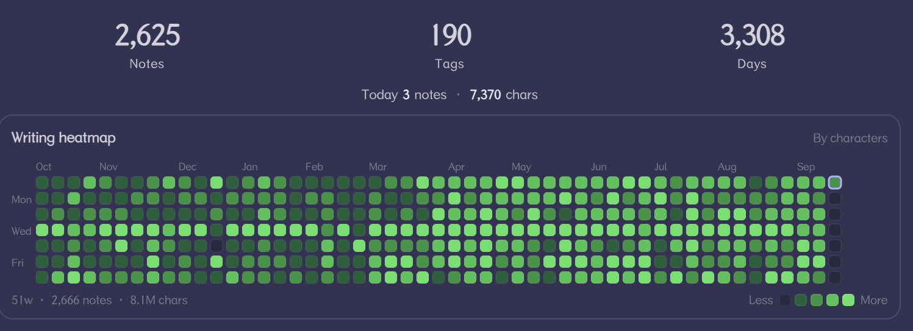

# Writing Heatmap

An Obsidian plugin that shows your writing activity as a GitHub-style heatmap in the sidebar, together with a few basic statistics about your vault.

[](https://github.com/0xAiKang/obsidian-writing-heatmap/releases/latest)
[](LICENSE)


[中文文档](README.zh-CN.md)



## Features

- A heatmap of the past year, shaded by how much you wrote each day. The grid resizes to fit the sidebar, from 8 weeks in a narrow dock up to a full 53-week year.
- Three counters above the grid: total notes, distinct tags, and days since your first note.
- A status bar item with today's note and character count.
- Hover a cell to see that day's date, note count and character count. Click it to open that day's daily note.
- Cells can be shaded by characters written or by notes created.
- Exclude folders and files with glob patterns, or use a whitelist to count only certain folders.
- English and Simplified Chinese, selected automatically from your Obsidian language setting.
- Colors follow the active Obsidian theme in both light and dark mode.

## Installation

### From Community Plugins

1. Open **Settings → Community plugins → Browse**.
2. Search for **Writing Heatmap**.
3. Click **Install**, then **Enable**.

### Manually

1. Download `main.js`, `manifest.json` and `styles.css` from the [latest release](https://github.com/0xAiKang/obsidian-writing-heatmap/releases/latest).
2. Copy them into `<vault>/.obsidian/plugins/writing-heatmap/`.
3. Reload Obsidian and enable the plugin under **Settings → Community plugins**.

## Usage

The panel opens in the right sidebar the first time you enable the plugin. After that Obsidian remembers where you put it, including if you close it or move it somewhere else.

- Click the ribbon icon to bring the panel to the front. If it is already in front, the click collapses the sidebar.
- Click the status bar item for the same behaviour.
- Or run **Writing Heatmap: Toggle panel** from the command palette.

## Settings

| Setting | Description |
| --- | --- |
| Counted folders | Folders behind the note counter, one path per line. Empty (the default) counts the whole vault. The tag and day counters are always vault-wide. |
| Exclude patterns | Files and folders to keep out of the heatmap, one glob per line. The folder configured in the Templates core plugin is excluded automatically. |
| Include patterns | A whitelist. When it is not empty, only files matching one of these globs are counted. |
| Count code blocks | Whether characters inside code blocks and inline code count towards the daily total. Off by default. |
| Color cells by | Whether cell shade follows characters written or notes created. |
| Rebuild index | Rescans every file from scratch. Use it if the numbers look wrong. |

Glob syntax: `*` matches within one path segment, `**` crosses segments, and `?` matches a single character. A plain folder path such as `Templates` matches that folder and everything inside it.

## How a note is assigned to a day

The plugin looks for a date in this order and uses the first one it finds:

1. **The file name** — a date at the start of the name, such as `2026-05-01.md` or `2026-05-01-meeting.md`. A date in the middle of the name is ignored.
2. **The frontmatter** — the `created` key first, then `date`. Plain values (`2026-05-01 11:25`), quoted values, and links to a daily note (`created: "[[2026-05-01]]"`) all work.
3. **The file's creation time** — used only when the note carries no date of its own. It is the last resort because syncing, moving or restoring a vault rewrites it, which can collapse years of notes onto a single day.

Renaming a note or editing its frontmatter date moves it to the new day.

## How characters are counted

Markdown syntax is stripped first, then the remaining **characters** are counted — not words. Removed before counting: frontmatter, code blocks and inline code (unless you turn them on), image embeds, link targets, HTML tags, Markdown punctuation, and all whitespace.

So `Hello 世界` counts as 7. The plugin was written for Chinese notes, where characters are the usual unit. If you write mostly in English, read the number as a rough measure of volume rather than a word count.

## Development

```bash
git clone https://github.com/0xAiKang/obsidian-writing-heatmap.git
cd obsidian-writing-heatmap
npm install

npm run dev     # watch build
npm test        # unit tests
npm run build   # typecheck, tests, production bundle
```

Source layout: `tracker.ts` keeps the per-day totals, `stats.ts` computes the three counters, `note-date.ts` resolves which day a note belongs to, `heatmap.ts` draws the grid, `view.ts` is the sidebar panel, and `i18n.ts` holds both language tables.

## License

[MIT](LICENSE)
