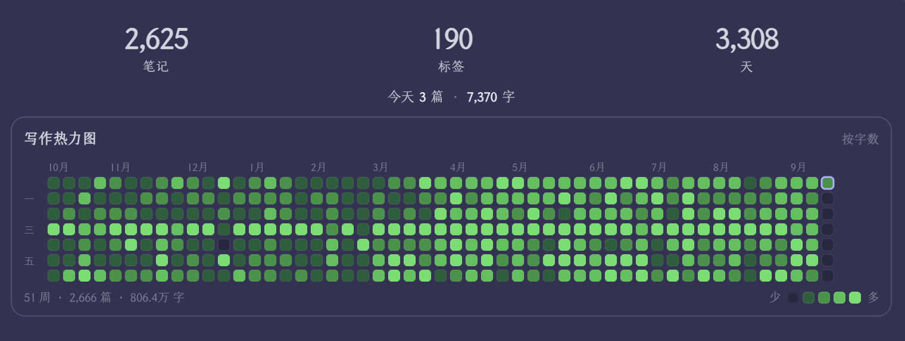

# Writing Heatmap

一个 Obsidian 插件，在侧栏用 GitHub 风格的热力图展示写作活动，并附带几个基础的库统计数据。

[](https://github.com/0xAiKang/obsidian-writing-heatmap/releases/latest)
[](LICENSE)


[English](README.md)



## 功能

- 最近一年的热力图，格子深浅对应当天的写作量。网格宽度随侧栏自适应，窄栏显示 8 周，拉宽最多显示 53 周。
- 网格上方三个数字：笔记总数、去重后的标签数、距第一篇笔记的天数。
- 状态栏常驻显示今天的篇数和字数。
- 鼠标悬停格子可查看当天的日期、篇数和字数，点击格子打开当天的日记。
- 格子配色可按字数或按笔记数。
- 支持 glob 规则排除文件和目录，也可以用白名单只统计指定目录。
- 中英双语界面，跟随 Obsidian 的语言设置自动切换。
- 颜色取自 Obsidian 主题变量，深色和浅色主题都适配。

## 安装

### 从社区插件市场安装

1. 打开 **设置 → 第三方插件 → 浏览**。
2. 搜索 **Writing Heatmap**。
3. 点击 **安装**，然后 **启用**。

### 手动安装

1. 从 [最新 release](https://github.com/0xAiKang/obsidian-writing-heatmap/releases/latest) 下载 `main.js`、`manifest.json` 和 `styles.css`。
2. 放进 `<库目录>/.obsidian/plugins/writing-heatmap/`。
3. 重启 Obsidian，在 **设置 → 第三方插件** 里启用。

## 使用

首次启用时，面板会自动在右侧栏打开。之后 Obsidian 会记住你放它的位置，包括你把它关掉或者拖到别处。

- 点击左侧 ribbon 图标把面板调到前台；如果面板已经在前台，则收起所在侧栏。
- 点击状态栏的数字，行为相同。
- 或在命令面板执行 **Writing Heatmap: 开关面板**。

## 设置项

| 设置项 | 说明 |
| --- | --- |
| 统计目录 | 「笔记」这个数字统计哪些目录，每行一个路径。留空（默认）表示统计全库。标签数和天数始终按全库计算。 |
| 排除规则 | 不计入热力图的文件和目录，每行一个 glob。Templates 核心插件配置的模板目录会自动排除。 |
| 白名单规则 | 填写后只统计匹配的文件，留空表示不启用。 |
| 统计代码块 | 代码块和行内代码里的字符是否计入每日字数，默认关闭。 |
| 配色依据 | 格子深浅按字数还是按笔记数。 |
| 重建索引 | 从头重新扫描所有文件，数据看起来不对时使用。 |

glob 语法：`*` 匹配单个路径层级内的任意字符，`**` 可跨层级，`?` 匹配单个字符。直接写目录名（如 `Templates`）表示匹配该目录及其下所有内容。

## 笔记归到哪一天

插件按以下顺序找日期，用第一个能找到的：

1. **文件名** —— 名称开头的日期，如 `2026-05-01.md` 或 `2026-05-01周五.md`。日期在名称中间的不算。
2. **frontmatter** —— 先看 `created`，再看 `date`。支持普通值（`2026-05-01 11:25`）、带引号的值，以及指向日记的双链（`created: "[[2026-05-01周五]]"`）。
3. **文件创建时间** —— 只在笔记本身没有任何日期信息时使用。它排在最后，是因为同步、迁移、恢复库都会重写这个时间戳，可能把多年的笔记压到同一天。

重命名笔记或修改 frontmatter 里的日期，笔记会重新归到新的那天。

## 字数怎么算

先剥掉 Markdown 语法，再统计剩下的**字符数**，不是单词数。统计前会去掉：frontmatter、代码块和行内代码（除非在设置里开启）、图片嵌入、链接地址、HTML 标签、Markdown 符号，以及所有空白字符。

所以 `Hello 世界` 算作 7。这个规则是按中文写作设计的。

## 开发

```bash
git clone https://github.com/0xAiKang/obsidian-writing-heatmap.git
cd obsidian-writing-heatmap
npm install

npm run dev     # 监听构建
npm test        # 单元测试
npm run build   # 类型检查、测试、生产构建
```

代码结构：`tracker.ts` 维护每天的统计，`stats.ts` 计算顶部三个数字，`note-date.ts` 负责判断笔记归到哪一天，`heatmap.ts` 绘制网格，`view.ts` 是侧栏面板，`i18n.ts` 存放中英文案。

## 许可证

[MIT](LICENSE)
